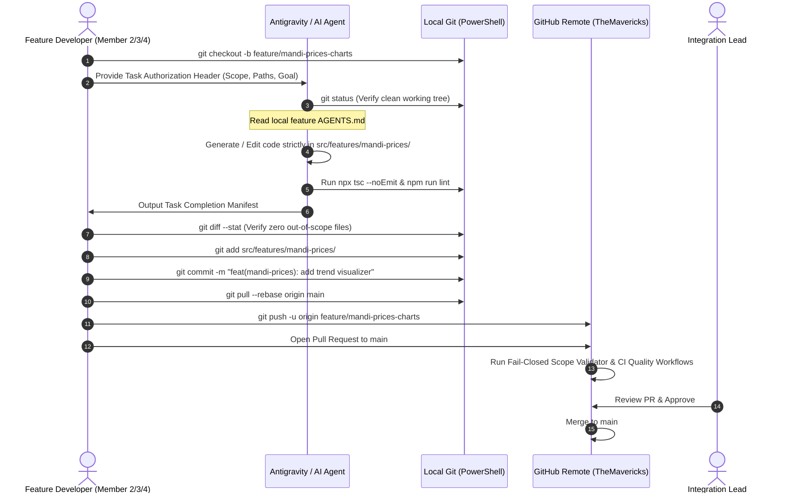
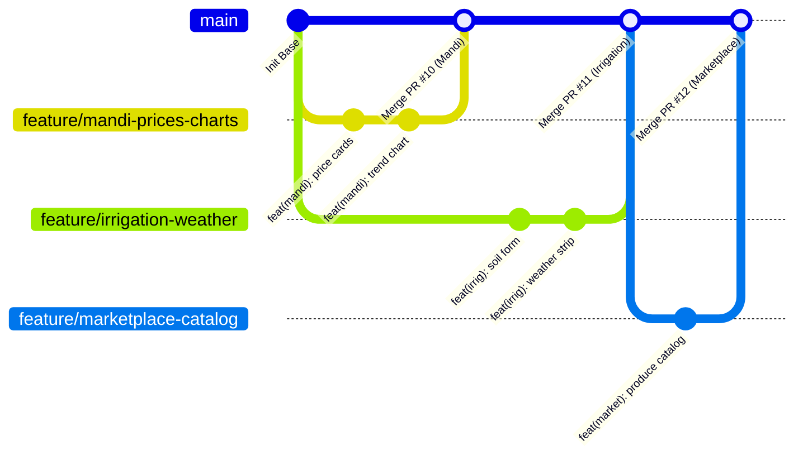
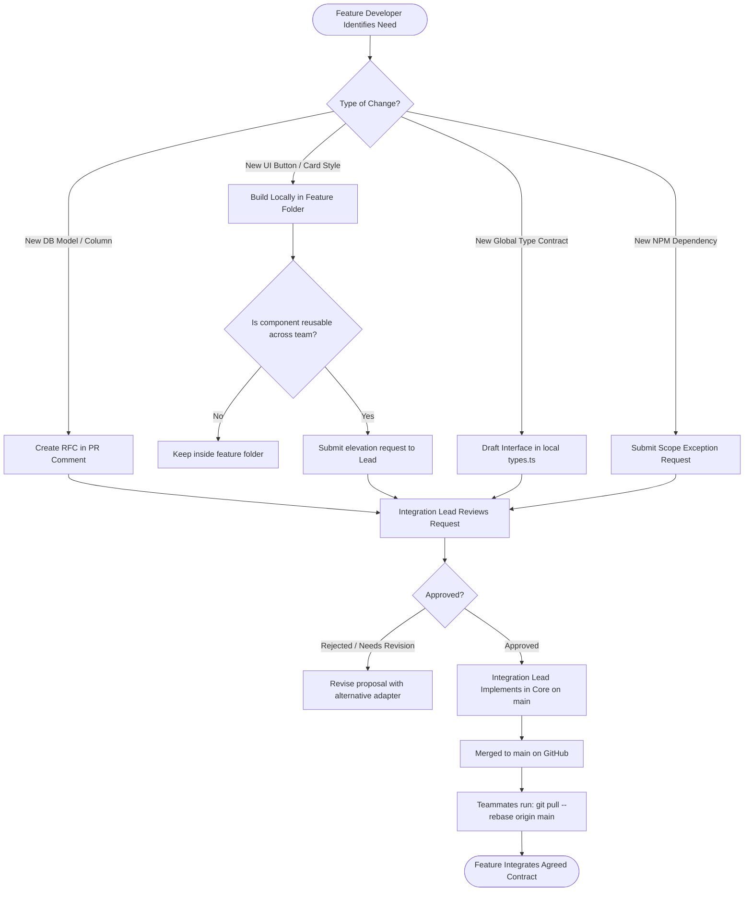
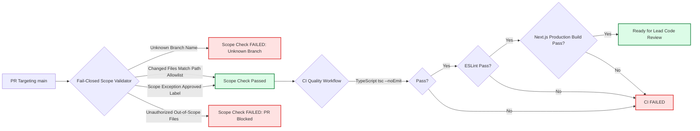
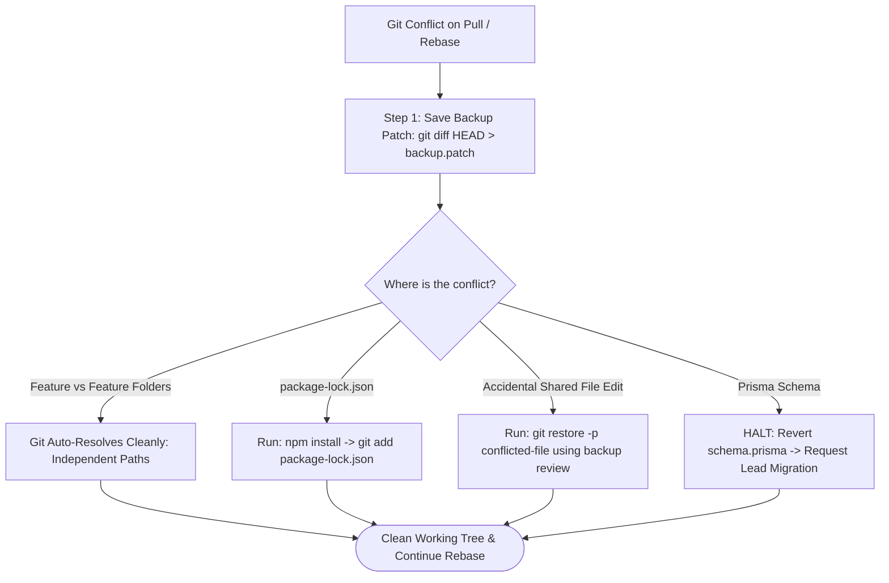

# Role-Based, AI-Safe Git Collaboration Workflow & Governance Blueprint for AgroSaathi

> **Document Status**: REVISED ARCHITECTURAL PROPOSAL (Incorporating Architecture Review Feedback)  
> **Author**: Senior Software Architect, Git Workflow Engineer & Repository Governance Engineer  
> **Target Repository**: `https://github.com/VivekNCodes/TheMavericks.git`  
> **Local Workspace**: `M:\Projects\HackShift`  
> **Applicability**: Human Teammates (4 Members) & AI Coding Agents (Google Antigravity, Claude Code, GitHub Copilot)  
> **Implementation State**: Strictly Proposal Document Only. No application code, `.gitignore`, or repository settings modified.

---

## Table of Contents
1. [Executive Summary & Architectural Philosophy](#1-executive-summary--architectural-philosophy)
2. [Current Repository Structure & Architecture](#2-current-repository-structure--architecture)
3. [Git & .gitignore Audit Findings (Deep-Dive Analysis)](#3-git--gitignore-audit-findings-deep-dive-analysis)
4. [Role-Based Ownership Matrix & Boundary Definitions](#4-role-based-ownership-matrix--boundary-definitions)
5. [Human & AI-Agent Permission Model (The 4-Layer Security Envelope)](#5-human--ai-agent-permission-model-the-4-layer-security-envelope)
6. [Hierarchical AGENTS.md Architecture (Layers A & B)](#6-hierarchical-agentsmd-architecture-layers-a--b)
7. [Task-Level Authorization Protocol (Layer C)](#7-task-level-authorization-protocol-layer-c)
8. [Change Manifest & Verification Protocol (Layer D)](#8-change-manifest--verification-protocol-layer-d)
9. [Git Branching Strategy for Distributed Teammate Laptops](#9-git-branching-strategy-for-distributed-teammate-laptops)
10. [Step-by-Step Local Development Workflow (Windows 11 / PowerShell)](#10-step-by-step-local-development-workflow-windows-11--powershell)
11. [Commit, Scoped Staging & Pull Request Protocols](#11-commit-scoped-staging--pull-request-protocols)
12. [Controlled Exception Process for Shared Files](#12-controlled-exception-process-for-shared-files)
13. [Shared-Component & Database Governance Contract](#13-shared-component--database-governance-contract)
14. [Automated Scope Enforcement Architecture (Fail-Closed Design)](#14-automated-scope-enforcement-architecture-fail-closed-design)
15. [Testing, Static Analysis & Hardened CI Pipeline](#15-testing-static-analysis--hardened-ci-pipeline)
16. [Environment & Secret Management Policy](#16-environment--secret-management-policy)
17. [Conflict Resolution & Non-Destructive Recovery Procedures](#17-conflict-resolution--non-destructive-recovery-procedures)
18. [Threat Modeling & Failure Mode Analysis](#18-threat-modeling--failure-mode-analysis)
19. [Phased Implementation Roadmap & Rollout Pilot Checklist](#19-phased-implementation-roadmap--rollout-pilot-checklist)
20. [Acceptance Criteria & Verification Checklist](#20-acceptance-criteria--verification-checklist)
21. [Unresolved Questions, Assumptions & Reviewer Decisions](#21-unresolved-questions-assumptions--reviewer-decisions)
22. [Architecture & Workflow Diagrams (Mermaid A–F)](#22-architecture--workflow-diagrams-mermaid-af)

---

## 1. Executive Summary & Architectural Philosophy

AgroSaathi is a modular monolithic agricultural assistance application built with Next.js 14 (App Router), React 18, TypeScript, Tailwind CSS, Neon Serverless PostgreSQL (via Prisma ORM), and deployed to Vercel.

The project is developed concurrently by a four-person engineering team working from separate laptops:
- **Integration Lead & Architect** (`@VivekNCodes`): Core application shell, shared UI design system, routing, database schema/migrations, auth, Crop Disease Detection AI, FAO-56 Crop Growing Planner, and AI Sahayak (Chatbot).
- **Member 2 (Agronomic Market Specialist)**: Mandi Price Intelligence module (`src/features/mandi-prices/`).
- **Member 3 (IoT & Irrigation Specialist)**: Smart Irrigation Advisor module (`src/features/irrigation/`).
- **Member 4 (Agri-Commerce Specialist)**: Farmer Direct Marketplace module (`src/features/marketplace/`).

Every developer employs agentic AI coding assistants (such as Google Antigravity, Claude Code, or GitHub Copilot) to accelerate delivery. While AI agents drastically shorten implementation cycles, they present systemic risks when operating on shared repositories:
1. **Silent Scope Creep**: Agents modify shared layouts, global styles, or unrelated modules to satisfy localized visual requests.
2. **Database Migration Collisions**: Concurrent, uncoordinated execution of `prisma migrate dev` creates conflicting schema histories.
3. **Blanket Staging Leaks**: Agents issuing blanket `git add .` commands stage untracked scratch files, experimental fixtures, or local secrets.
4. **Fragile Overwriting**: Naive recovery commands overwrite uncommitted developer diffs without preservation.

### Core Philosophy: Pragmatic, Fail-Closed, Non-Bloated Governance
This architecture establishes **deterministic module isolation**, **role-based boundaries**, and **fail-closed CI verification**. It avoids complex enterprise monorepo tooling (e.g., Nx, Turborepo, or heavyweight SaaS bots) and instead relies on:
- Lightweight, native Windows 11 PowerShell local commands.
- Transparent JSON/YAML scope mapping (`.github/scope-policy.json`).
- GitHub Actions diff inspection comparing exact pull-request base and head SHAs.
- Mandatory diff preservation prior to any rollback or conflict resolution.

---

## 2. Current Repository Structure & Architecture

The repository adheres to a clean feature-sliced layout:

```text
M:\Projects\HackShift\ (Repository Root)
├── .env.example                     # Reference template for environment variables
├── .env.local                       # Untracked local developer secrets (REDACTED)
├── .eslintrc.json                   # Next.js ESLint configuration
├── .gitignore                       # Git ignore rules (45 lines audited)
├── AGENTS.md                        # Master repository multi-agent protocol
├── README.md                        # Project documentation
├── next.config.mjs                  # Next.js bundler configuration
├── package.json                     # Root dependencies and lifecycle scripts
├── postcss.config.js                # Tailwind PostCSS configuration
├── tailwind.config.ts               # Krishi-* color palette tokens & styling rules
├── tsconfig.json                    # Strict TypeScript compiler configuration
├── docs/                            # Architectural specifications & guidelines
│   ├── API_CONTRACTS.md             # Unified API response envelope and contracts
│   ├── ARCHITECTURE.md              # System architecture & modular monolith design
│   ├── CHATBOT_SETUP.md             # AI Sahayak Gemini API setup
│   ├── DATABASE_GUIDELINES.md       # Neon PostgreSQL connection pooling rules
│   ├── DEPLOYMENT.md                # Vercel deployment instructions
│   ├── ENVIRONMENT_SETUP.md         # Environment variable setup
│   ├── GIT_WORKFLOW.md              # High-level Git workflow
│   ├── MODULE_OWNERSHIP.md          # Team member assignments
│   ├── PROJECT_OVERVIEW.md          # AgroSaathi mission and functional overview
│   ├── PROJECT_RULES.md             # Team collaboration golden rules
│   ├── TECHNICAL_APPROACH.md        # Technical architecture specification
│   ├── TEST_PLAN.md                 # Validation and testing checklist
│   └── architecture/                # Proposed governance blueprints
│       └── role-based-ai-development-workflow.md
├── prisma/                          # Database schema and migrations
│   └── schema.prisma                # Neon PostgreSQL models (6 core domains)
├── public/                          # Static assets and icons
└── src/
    ├── app/                         # Next.js App Router (Integration Lead Owned)
    │   ├── api/                     # Serverless API routes
    │   │   ├── assistant/           # AI Sahayak streaming API
    │   │   ├── crop-disease/        # Disease classification inference proxy
    │   │   ├── crop-planner/        # FAO-56 crop calculation API
    │   │   ├── health/              # Health & DB check endpoint
    │   │   └── weather/             # Meteorological proxy endpoint
    │   ├── assistant/               # AI Assistant dedicated route
    │   ├── chat/                    # Chat session route
    │   ├── crop-disease/            # Crop Disease feature page route
    │   ├── crop-planner/            # Crop Growing Planner route
    │   ├── dashboard/               # Farmer main overview dashboard
    │   ├── irrigation/              # Smart Irrigation page route
    │   ├── mandi-prices/            # Mandi Prices page route
    │   ├── marketplace/             # Marketplace page route
    │   ├── error.tsx                # Global route error boundary
    │   ├── globals.css              # Global Tailwind CSS and base styles
    │   ├── layout.tsx               # Root HTML wrapper and font definitions
    │   ├── loading.tsx              # Root Suspense fallback
    │   ├── not-found.tsx            # Global 404 handler
    │   └── page.tsx                 # Root landing page / redirection
    ├── components/                  # Shared UI Library (Integration Lead Owned)
    │   ├── layout/                  # AppShell, Sidebar, Header, MobileNav
    │   ├── shared/                  # PageHeader, LoadingState, EmptyState, ErrorState
    │   └── ui/                      # Atomic tokens: Button, Badge, Card, Input
    ├── config/                      # Navigation and site constants
    ├── features/                    # Modular Feature Slices
    │   ├── chatbot/                 # AgroSaathi AI Sahayak (Lead Owned)
    │   ├── crop-disease/            # Crop Disease Detection (Lead Owned)
    │   │   └── AGENTS.md            # Feature-specific AI protocol
    │   ├── crop-planner/            # Crop Growing Planner (Lead Owned)
    │   ├── irrigation/              # Smart Irrigation Advisor (Member 3 Owned)
    │   │   └── AGENTS.md            # Feature-specific AI protocol
    │   ├── mandi-prices/            # Mandi Price Intelligence (Member 2 Owned)
    │   │   └── AGENTS.md            # Feature-specific AI protocol
    │   └── marketplace/             # Farmer Direct Marketplace (Member 4 Owned)
    │       └── AGENTS.md            # Feature-specific AI protocol
    ├── lib/                         # Shared utilities, Prisma client, API envelope
    └── types/                       # Shared TypeScript domain contracts
```

---

## 3. Git & .gitignore Audit Findings (Deep-Dive Analysis)

### 3.1 Git Repository Current State
- **Branch**: `main`
- **Remote**: `https://github.com/VivekNCodes/TheMavericks.git`
- **Working Tree**: Clean. Zero uncommitted changes to tracked files.
- **Head Commit**: `7446c9c` ("Update AgroSaathi project crop detection").

### 3.2 The 5 Distinct Layers of File Access & Protection
A common misconception in multi-agent development is assuming `.gitignore` provides security or access control. The table below details what each layer actually controls:

| Mechanism | Operating Realm | What It Actually Does | What It CANNOT Do (Common Fallacies) |
|---|---|---|---|
| **1. `.gitignore`** | Local Git Index | Excludes **untracked** files from showing up in status or being staged by bulk adds. | **Cannot** protect tracked files. **Cannot** prevent an agent from modifying local files. **Cannot** restrict commits to tracked source code. |
| **2. Scoped Staging (`git add <path>`)** | Local Git Staging Area | Selectively places specific modified files into the commit index. | **Cannot** prevent an agent from staging files if the agent executes `git add .`. Requires strict agent instructions. |
| **3. OS File System ACLs** | Local Operating System | Restricts write access to files at the OS user account level. | **Cannot** be tracked across Git clones. Git does not store Windows ACL permissions. |
| **4. AI Agent Prompts (`AGENTS.md`)** | LLM Reasoning Loop | Instructs the model's planning logic to respect boundaries. | **Cannot** guarantee 100% compliance if the agent hallucinates, experiences prompt drift, or misinterprets instructions. |
| **5. Remote Branch Protection & CI (GitHub)** | Remote Server (`github.com`) | Evaluates pull requests against automated checks and blocks merging unless approved. | **True, tamper-proof security gate**. An agent on a local laptop cannot bypass remote GitHub branch rulesets. |

### 3.3 Line-by-Line Audit of Current `.gitignore`
Using `git check-ignore -v` and `git ls-files -i -c --exclude-standard`:
- **Result**: Zero tracked source files are ignored. No teammate feature directories are excluded.
- **Lines 1–8 (`node_modules/`, etc.)**: Necessary dependency exclusions.
- **Lines 9–11 (`/coverage`)**: Test artifact exclusion.
- **Lines 12–18 (`/.next/`, `/build`)**: Next.js compilation cache exclusions.
- **Lines 19–22 (`.DS_Store`, `*.pem`)**: OS files and cryptographic private keys.
- **Lines 28–31 (`.env*.local`, `.env`)**: Critical secret exclusions.
- **Lines 35–38 (`*.tsbuildinfo`, `next-env.d.ts`)**: TypeScript build metadata.
- **Lines 41–45 (`Plant-Disease-Classification/`, `.venv/`, `__pycache__/`)**: Machine learning model weights (`.pt`) and local virtual environments. Crucial to keep multi-hundred-megabyte binaries out of the Next.js Git history.

---

## 4. Role-Based Ownership Matrix & Boundary Definitions

The feature ownership model is established according to repository instructions in `AGENTS.md`, `docs/MODULE_OWNERSHIP.md`, and `docs/PROJECT_RULES.md`.

### 4.1 Master Ownership Table

| Module / Scope | Path Pattern | Primary Owner | Backup Reviewer | Permitted Dependencies | Database Permissions |
|---|---|---|---|---|---|
| **Core Architecture & Shell** | `src/app/layout.tsx`<br>`src/app/page.tsx`<br>`src/app/globals.css`<br>`src/components/layout/**`<br>`src/config/**` | **Integration Lead** (`@VivekNCodes`) | Member 2 | Tailwind, Lucide React, Next.js | Read/Write (Full schema authority) |
| **Shared Design System** | `src/components/ui/**`<br>`src/components/shared/**` | **Integration Lead** (`@VivekNCodes`) | Member 4 | `clsx`, `tailwind-merge`, Lucide | None (UI tokens only) |
| **Shared Libraries & Contracts** | `src/lib/**`<br>`src/types/**` | **Integration Lead** (`@VivekNCodes`) | Member 3 | Prisma Client, standard utilities | Read/Write (Client singleton) |
| **Database Schema & Migrations** | `prisma/schema.prisma`<br>`prisma/migrations/**` | **Integration Lead** (`@VivekNCodes`) | All Members | Neon PostgreSQL engine | Full Migration Authority |
| **Crop Disease Detection** | `src/features/crop-disease/**`<br>`src/app/crop-disease/**`<br>`src/app/api/crop-disease/**` | **Integration Lead** (`@VivekNCodes`) | Member 3 | Shared UI, HTTP inference client | Reads/Writes `DiseaseLog` |
| **Crop Growing Planner** | `src/features/crop-planner/**`<br>`src/app/crop-planner/**`<br>`src/app/api/crop-planner/**` | **Integration Lead** (`@VivekNCodes`) | Member 2 | Shared UI, agronomic engine | Reads/Writes `CropPlan` |
| **AI Assistant (Chatbot)** | `src/features/chatbot/**`<br>`src/app/assistant/**`<br>`src/app/chat/**`<br>`src/app/api/assistant/**` | **Integration Lead** (`@VivekNCodes`) | Member 4 | Google GenAI SDK (`@google/genai`) | Reads/Writes `ChatSession` |
| **Mandi Price Intelligence** | `src/features/mandi-prices/**`<br>`src/app/mandi-prices/**` | **Member 2** | Integration Lead (`@VivekNCodes`) | Shared UI, Charting libs | Reads `MandiPrice` (No migrations) |
| **Smart Irrigation Advisor** | `src/features/irrigation/**`<br>`src/app/irrigation/**` | **Member 3** | Integration Lead (`@VivekNCodes`) | Shared UI, date utilities | Reads `IrrigationLog` (No migrations) |
| **Farmer Direct Marketplace** | `src/features/marketplace/**`<br>`src/app/marketplace/**` | **Member 4** | Integration Lead (`@VivekNCodes`) | Shared UI, form state | Reads `MarketplaceListing`, `MarketplaceInquiry` |
| **Repository Tooling & CI** | `.github/**`<br>`package.json`<br>`tsconfig.json`<br>`next.config.mjs` | **Integration Lead** (`@VivekNCodes`) | All Members | Node/npm packages | Configuration only |

> [!NOTE]
> **Explicit Assumption Marker**: Teammate GitHub usernames (`Member 2`, `Member 3`, `Member 4`) are currently unverified in repository configuration and will be populated upon contributor onboarding.

---

## 5. Human & AI-Agent Permission Model (The 4-Layer Security Envelope)

AgroSaathi employs a **4-Layer Defense-in-Depth Security Envelope**:

```text
┌─────────────────────────────────────────────────────────────────┐
│ LAYER A: Repository-Wide Policy (Root AGENTS.md)                │
│ -> Universal ethical, operational, and boundary rules           │
└────────────────────────────────┬────────────────────────────────┘
                                 │
                                 ▼
┌─────────────────────────────────────────────────────────────────┐
│ LAYER B: Feature-Specific Policy (Feature AGENTS.md)            │
│ -> Local module scope, prohibited folders, local dev procedures  │
└────────────────────────────────┬────────────────────────────────┘
                                 │
                                 ▼
┌─────────────────────────────────────────────────────────────────┐
│ LAYER C: Task-Level Authorization (Structured Task Header)      │
│ -> Explicit Task ID, allowed path allowlist, fail-closed check  │
└────────────────────────────────┬────────────────────────────────┘
                                 │
                                 ▼
┌─────────────────────────────────────────────────────────────────┐
│ LAYER D: Change Manifest & Verification (Post-Task Diff Audit)  │
│ -> Independent comparison of agent claim vs actual git diff     │
└─────────────────────────────────────────────────────────────────┘
```

### The 13 Golden Commandments for AI Coding Agents in AgroSaathi

1. **Pre-flight Status Inspection**: Always run `git status` prior to modifying files. Never begin work if uncommitted foreign changes exist.
2. **Boundary Confinement**: Never open, edit, or format files outside your assigned feature folder.
3. **Strict Path Staging**: Never run `git add .` or `git add -A`. Only stage specifically authorized files by path (`git add src/features/mandi-prices/...`).
4. **Preserve Teammate Diff**: Never overwrite or revert uncommitted changes belonging to a teammate.
5. **Zero Secret Commits**: Never stage or commit `.env`, `.env.local`, API keys, database connection strings, or bearer tokens.
6. **Zero Model Weight Commits**: Never commit PyTorch weights (`.pt`), ONNX checkpoints, or large binary files into Git.
7. **No Broad Formatting**: Never run repository-wide prettier/linter re-formatting that touches files outside your module.
8. **No `.gitignore` Circumvention**: Never modify `.gitignore` to mask merge conflicts or hide source code.
9. **No History Rewriting**: Strictly forbid `git push --force`, `git reset --hard`, and `git clean -fd` on shared branches.
10. **Data Honesty**: Never output fabricated "live" telemetry. Clearly label mock data in component previews.
11. **Strict TypeScript Typing**: No `any` types. All domain models and API responses must have strict interfaces.
12. **Server Components by Default**: Only add `'use client'` when state, event listeners, or browser APIs are indispensable.
13. **Stop & Escalate on Scope Blockers**: If fulfilling a requirement requires modifying a shared component, package manifest, or Prisma schema, **HALT immediately**. Do not edit the file. Output a formal Change Request.

---

## 6. Hierarchical AGENTS.md Architecture (Layers A & B)

- **Layer A (Root `AGENTS.md`)**: Defines universal boundary rules and reporting requirements.
- **Layer B (Feature `AGENTS.md`)**: Configured per feature slice:
  - `src/features/mandi-prices/AGENTS.md` (Active)
  - `src/features/irrigation/AGENTS.md` (Active)
  - `src/features/marketplace/AGENTS.md` (Active)
  - `src/features/crop-disease/AGENTS.md` (Active)
  - `src/features/crop-planner/AGENTS.md` *(Proposed Phase 2)*
  - `src/features/chatbot/AGENTS.md` *(Proposed Phase 2)*

---

## 7. Task-Level Authorization Protocol (Layer C)

Every developer must supply a standardized **Task Authorization Header** at the start of an AI coding session:

```markdown
### AGROSAATHI AI TASK AUTHORIZATION HEADER
- Task ID: TASK-IRRIG-201
- Assigned Developer: Member 3 (IoT & Irrigation Specialist)
- Assigned Module: irrigation
- Authorized Feature Branch: feature/irrigation-weather-strip
- Base Branch: main
- Objective: Connect 5-day weather forecast strip to mock weather service
- Explicitly Allowed Path Patterns:
  - src/features/irrigation/**
  - src/app/irrigation/**
- Strictly Forbidden Paths:
  - src/app/layout.tsx
  - src/components/**
  - src/lib/**
  - prisma/**
  - package.json
- Database Migration Required: NO
- Shared UI Changes Required: NO
- Required Pre-Commit Validation: npx tsc --noEmit && npm run lint
```

If the AI agent determines that a file outside `Explicitly Allowed Path Patterns` needs editing, it must stop execution and output an escalation prompt rather than making the edit.

---

## 8. Change Manifest & Verification Protocol (Layer D)

Upon task completion, the AI agent must output a structured **Change Manifest**:

```markdown
### AGROSAATHI TASK COMPLETION MANIFEST
- Task ID: TASK-IRRIG-201
- Timestamp: 2026-10-18T02:30:00Z
- Agent Identity: Antigravity IDE Agent

1. Files Inspected:
   - src/features/irrigation/components/IrrigationPreview.tsx
   - src/features/irrigation/types.ts

2. Files Created:
   - src/features/irrigation/components/WeatherForecastStrip.tsx

3. Files Modified:
   - src/features/irrigation/components/IrrigationPreview.tsx
   - src/features/irrigation/types.ts

4. Files Deleted:
   - None

5. Out-of-Scope Files Modified:
   - NONE (100% boundary compliance)

6. Validation Results:
   - TypeScript (`npx tsc --noEmit`): PASSED (0 errors)
   - Linter (`npm run lint`): PASSED (0 warnings)

7. Diff Verification (Human Check):
   - Developer executed: `git diff --stat` to verify output.
```

---

## 9. Git Branching Strategy for Distributed Teammate Laptops

### 9.1 Branch Naming Taxonomy
- `main`: Production integration branch. Protected. Direct pushes blocked.
- `feature/mandi-prices-<slug>`: Mandi price intelligence tasks.
- `feature/irrigation-<slug>`: Irrigation advisor tasks.
- `feature/marketplace-<slug>`: Marketplace tasks.
- `feature/crop-disease-<slug>`: Crop disease detection tasks.
- `feature/core-<slug>`: Integration Lead core tasks.
- `fix/<module>-<slug>`: Scoped bugfixes.
- `docs/<slug>`: Architecture and documentation proposals.

### 9.2 The Single-Feature Isolation Principle
Each branch must encapsulate **only one feature task**. Never bundle changes across multiple modules on a single branch.

---

## 10. Step-by-Step Local Development Workflow (Windows 11 / PowerShell)

All commands are tested and optimized for Windows 11 PowerShell in VS Code.

### Phase 1: Initial Local Setup (One-Time)
```powershell
# 1. Clone the repository
cd M:\Projects
git clone https://github.com/VivekNCodes/TheMavericks.git HackShift
cd HackShift

# 2. Clean dependency installation
npm install

# 3. Initialize local environment file
Copy-Item .env.example .env.local

# 4. Generate local Prisma client
npm run prisma:generate

# 5. Start development server
npm run dev
```

### Phase 2: Starting a New Scoped Task
```powershell
# 1. Ensure main is up to date and clean
git checkout main
git fetch origin
git pull --ff-only origin main

# 2. Create your isolated feature branch
git checkout -b feature/mandi-prices-trend-charts
```

### Phase 3: Local Development & Independent Preview
```powershell
# Run the local server and verify your module:
npm run dev
# Mandi Prices: http://localhost:3000/mandi-prices
# Irrigation:   http://localhost:3000/irrigation
# Marketplace:  http://localhost:3000/marketplace
```

### Phase 4: Pre-Commit Quality Checks
```powershell
# 1. Verify TypeScript types
npx tsc --noEmit

# 2. Verify ESLint rules
npm run lint

# 3. Inspect modified files
git status -s
git diff --stat
```

### Phase 5: Scoped Staging (NEVER `git add .`)
```powershell
# Explicitly stage ONLY your feature directory:
git add src/features/mandi-prices/

# Commit with a clear Conventional Commit message:
git commit -m "feat(mandi-prices): implement 7D/1M modal price trend chart"
```

### Phase 6: Syncing with Main Before Pull Request (Rebase)
```powershell
# Fetch remote main updates
git fetch origin

# Rebase your feature commits onto latest main
git rebase origin/main

# Push your branch to GitHub
git push -u origin feature/mandi-prices-trend-charts
```

---

## 11. Commit, Scoped Staging & Pull Request Protocols

1. **Conventional Commits**: `feat(module): description`, `fix(module): description`, `docs(scope): description`.
2. **Never Stage Blindly**: Do not use `git add .`. Explicitly stage changed paths.
3. **Pull Request Requirements**:
   - Descriptive title and summary.
   - Verified viewport responsiveness (Desktop 1280px, Mobile 375px).
   - Confirmation of `npx tsc --noEmit` and `npm run lint`.
   - Clear confirmation of zero unauthorized paths.

---

## 12. Controlled Exception Process for Shared Files

When a feature implementation genuinely requires modifying shared infrastructure:
- `package.json` / `package-lock.json` (Adding an npm package)
- `docs/API_CONTRACTS.md` (Updating an API contract)
- `src/types/` (Adding or refining a shared type)
- `src/components/ui/` (Elevating a component to the design system)
- `prisma/schema.prisma` (Proposing a database field)

### 12.1 The Exception Request Protocol
1. **Local Proposal**: The teammate implements the feature locally using mock types or local helper components inside `src/features/<module>/`.
2. **RFC Submission**: The teammate opens an issue or pull request comment with an explicit **Scope Exception Request**:
   ```markdown
   ### SCOPE EXCEPTION REQUEST
   - Target Shared Files: package.json, package-lock.json
   - Proposed Package: recharts@^2.12.0
   - Justification: Required for Mandi Prices 7D/1M visual price trend charts.
   - Bundle Impact: ~45KB gzipped.
   - Requested Approver: @VivekNCodes
   ```
3. **Lead Review & Approval**: The Integration Lead (`@VivekNCodes`) reviews bundle impact, security, and architectural fit.
4. **Controlled Integration**:
   - *Option A*: The Lead applies the shared change to `main` directly. The teammate then runs `git pull --rebase origin main`.
   - *Option B*: The Lead applies the `scope-exception:approved` label to the teammate's PR and records authorization. The Scope Validator acknowledges this override token.

---

## 13. Shared-Component & Database Governance Contract

### 13.1 Shared UI Governance (`src/components/ui/`)
- Existing atomic tokens: `<Button>`, `<Badge>`, `<Card>`, `<Input>`.
- Features maintain feature-specific components inside `src/features/<module>/components/`.
- Components are only elevated to `src/components/ui/` after review by the Integration Lead.

### 13.2 Database Schema & Migration Architecture (Dev vs. Prod)
A strict distinction is drawn between **creating a migration**, **testing it locally**, and **deploying it to production**:

```text
┌────────────────────────────────────────────────────────────────────────┐
│ STEP 1: RFC & Schema Modification (Lead Only)                          │
│ Integration Lead modifies prisma/schema.prisma on dedicated branch.    │
└───────────────────────────────────┬────────────────────────────────────┘
                                    │
                                    ▼
┌────────────────────────────────────────────────────────────────────────┐
│ STEP 2: Development Migration Generation (Local / Dev DB Only)         │
│ Command: npx prisma migrate dev --name <migration_name>                │
│ -> Generates timestamped SQL: prisma/migrations/<timestamp>_name/      │
└───────────────────────────────────┬────────────────────────────────────┘
                                    │
                                    ▼
┌────────────────────────────────────────────────────────────────────────┐
│ STEP 3: Migration Safety & SQL Review                                  │
│ Lead inspects SQL for: table locks, destructive drops, non-null        │
│ columns lacking default values, or potential data loss.                │
└───────────────────────────────────┬────────────────────────────────────┘
                                    │
                                    ▼
┌────────────────────────────────────────────────────────────────────────┐
│ STEP 4: Deployment to Neon PostgreSQL (Staging / Production)           │
│ Command: npx prisma migrate deploy                                     │
│ (Executed strictly in CI/CD or controlled deployment window.           │
│ NEVER run `migrate dev` against a shared or production database!)      │
└───────────────────────────────────┬────────────────────────────────────┘
                                    │
                                    ▼
┌────────────────────────────────────────────────────────────────────────┐
│ STEP 5: Teammate Client Synchronization                                │
│ Teammates pull main and run: npm run prisma:generate                   │
│ (Generates updated @prisma/client TypeScript types locally).          │
└────────────────────────────────────────────────────────────────────────┘
```

---

## 14. Automated Scope Enforcement Architecture (Fail-Closed Design)

### 14.1 Scope Policy Map (`.github/scope-policy.json`)
This proposed JSON policy file defines authorized paths per module:

```json
{
  "version": "1.0.0",
  "modules": {
    "mandi-prices": {
      "branchPattern": "^feature/mandi-prices-.*",
      "allowedPaths": [
        "src/features/mandi-prices/**",
        "src/app/mandi-prices/**"
      ]
    },
    "irrigation": {
      "branchPattern": "^feature/irrigation-.*",
      "allowedPaths": [
        "src/features/irrigation/**",
        "src/app/irrigation/**"
      ]
    },
    "marketplace": {
      "branchPattern": "^feature/marketplace-.*",
      "allowedPaths": [
        "src/features/marketplace/**",
        "src/app/marketplace/**"
      ]
    },
    "crop-disease": {
      "branchPattern": "^feature/crop-disease-.*",
      "allowedPaths": [
        "src/features/crop-disease/**",
        "src/app/crop-disease/**",
        "src/app/api/crop-disease/**"
      ]
    },
    "crop-planner": {
      "branchPattern": "^feature/crop-planner-.*",
      "allowedPaths": [
        "src/features/crop-planner/**",
        "src/app/crop-planner/**",
        "src/app/api/crop-planner/**"
      ]
    },
    "chatbot": {
      "branchPattern": "^feature/chatbot-.*",
      "allowedPaths": [
        "src/features/chatbot/**",
        "src/app/assistant/**",
        "src/app/chat/**",
        "src/app/api/assistant/**"
      ]
    },
    "core": {
      "branchPattern": "^(feature/core-.*|lead/.*)",
      "allowedPaths": ["**"]
    }
  }
}
```

### 14.2 Fail-Closed Scope Validator Action (`.github/workflows/scope-validator.yml`)
This workflow inspects the exact pull request diff between `base.sha` and `head.sha`. **Unknown branches, missing module configurations, and unauthorized paths FAIL CLOSED immediately.**

```yaml
name: Scope Boundary Enforcement (Fail-Closed)

on:
  pull_request:
    branches: [main]

permissions:
  contents: read
  pull-requests: read

jobs:
  validate-scope:
    name: Verify PR Changed File Scope
    runs-on: ubuntu-latest
    steps:
      - name: Checkout Code with Full History
        uses: actions/checkout@v4
        with:
          fetch-depth: 0
          ref: ${{ github.event.pull_request.head.sha }}

      - name: Evaluate Scope Boundaries
        shell: pwsh
        run: |
          $baseSha = "${{ github.event.pull_request.base.sha }}"
          $headSha = "${{ github.event.pull_request.head.sha }}"
          $headBranch = "${{ github.head_ref }}"

          Write-Host "================ SCOPE VALIDATION ================"
          Write-Host "Base SHA:   $baseSha"
          Write-Host "Head SHA:   $headSha"
          Write-Host "Branch:     $headBranch"

          # 1. Fetch exact changed files between PR base and head SHAs
          $changedFiles = git diff --name-only $baseSha $headSha
          Write-Host "Changed Files Count: $($changedFiles.Count)"
          $changedFiles | ForEach-Object { Write-Host " - $_" }

          # 2. Check for Scope Exception Override Label
          $prLabels = "${{ join(github.event.pull_request.labels.*.name, ',') }}" -split ','
          $hasExceptionApproval = $prLabels -contains "scope-exception:approved"

          if ($hasExceptionApproval) {
              Write-Host "[OVERRIDE] Authorized scope-exception:approved label detected. Proceeding to review." -ForegroundColor Yellow
              exit 0
          }

          # 3. Identify Matching Module
          $matchedModule = $null
          if ($headBranch -match "^feature/mandi-prices-") { $matchedModule = "mandi-prices" }
          elseif ($headBranch -match "^feature/irrigation-") { $matchedModule = "irrigation" }
          elseif ($headBranch -match "^feature/marketplace-") { $matchedModule = "marketplace" }
          elseif ($headBranch -match "^feature/crop-disease-") { $matchedModule = "crop-disease" }
          elseif ($headBranch -match "^feature/crop-planner-") { $matchedModule = "crop-planner" }
          elseif ($headBranch -match "^feature/chatbot-") { $matchedModule = "chatbot" }
          elseif ($headBranch -match "^(feature/core-|lead/)") { $matchedModule = "core" }

          # FAIL CLOSED: Unknown branch naming
          if (-not $matchedModule) {
              Write-Error "FAIL-CLOSED: Branch '$headBranch' does not match any recognized feature naming pattern (e.g. feature/mandi-prices-*)."
              exit 1
          }

          Write-Host "Identified Module: $matchedModule"

          # 4. Check Allowed Paths
          $violatingFiles = @()

          if ($matchedModule -eq "mandi-prices") {
              $violatingFiles = $changedFiles | Where-Object { 
                  $_ -notlike "src/features/mandi-prices/*" -and 
                  $_ -notlike "src/app/mandi-prices/*"
              }
          }
          elseif ($matchedModule -eq "irrigation") {
              $violatingFiles = $changedFiles | Where-Object { 
                  $_ -notlike "src/features/irrigation/*" -and 
                  $_ -notlike "src/app/irrigation/*"
              }
          }
          elseif ($matchedModule -eq "marketplace") {
              $violatingFiles = $changedFiles | Where-Object { 
                  $_ -notlike "src/features/marketplace/*" -and 
                  $_ -notlike "src/app/marketplace/*"
              }
          }
          elseif ($matchedModule -eq "crop-disease") {
              $violatingFiles = $changedFiles | Where-Object { 
                  $_ -notlike "src/features/crop-disease/*" -and 
                  $_ -notlike "src/app/crop-disease/*" -and
                  $_ -notlike "src/app/api/crop-disease/*"
              }
          }
          elseif ($matchedModule -eq "crop-planner") {
              $violatingFiles = $changedFiles | Where-Object { 
                  $_ -notlike "src/features/crop-planner/*" -and 
                  $_ -notlike "src/app/crop-planner/*" -and
                  $_ -notlike "src/app/api/crop-planner/*"
              }
          }
          elseif ($matchedModule -eq "chatbot") {
              $violatingFiles = $changedFiles | Where-Object { 
                  $_ -notlike "src/features/chatbot/*" -and 
                  $_ -notlike "src/app/assistant/*" -and
                  $_ -notlike "src/app/chat/*" -and
                  $_ -notlike "src/app/api/assistant/*"
              }
          }
          # core module is allowed to touch anything

          # FAIL CLOSED: Any out-of-scope files detected
          if ($violatingFiles.Count -gt 0) {
              Write-Error "SCOPE VIOLATION DETECTED! The following files are outside the authorized scope for module '$matchedModule':"
              $violatingFiles | ForEach-Object { Write-Host "  [VIOLATION]: $_" -ForegroundColor Red }
              Write-Host "`nTo modify shared infrastructure, request a scope exception and acquire the 'scope-exception:approved' PR label."
              exit 1
          }

          Write-Host "SUCCESS: All changed files conform strictly to the authorized path allowlist." -ForegroundColor Green
```

### 14.3 Proposed GitHub `CODEOWNERS` File
Path: `.github/CODEOWNERS`

```text
# Global Application & Infrastructure
* @VivekNCodes

# Feature Specific Paths
# Note: Replace placeholder teammate handles upon onboarding
/src/features/mandi-prices/ @VivekNCodes
/src/app/mandi-prices/      @VivekNCodes

/src/features/irrigation/   @VivekNCodes
/src/app/irrigation/        @VivekNCodes

/src/features/marketplace/  @VivekNCodes
/src/app/marketplace/       @VivekNCodes

# Shared Core Infrastructure (Integration Lead Only)
/src/components/            @VivekNCodes
/src/app/layout.tsx         @VivekNCodes
/src/app/globals.css        @VivekNCodes
/src/lib/                   @VivekNCodes
/src/types/                 @VivekNCodes
/prisma/                    @VivekNCodes
/package.json               @VivekNCodes
/tsconfig.json              @VivekNCodes
```

> [!IMPORTANT]
> **CODEOWNERS vs. Enforced Approval**: CODEOWNERS merely triggers automatic review requests. To make approvals strictly mandatory before merging, the repository administrator must check **"Require review from Code Owners"** inside the GitHub Branch Protection Ruleset for `main`.

---

## 15. Testing, Static Analysis & Hardened CI Pipeline

### 15.1 Proposed CI Quality Pipeline (`.github/workflows/ci.yml`)
This workflow operates with least-privilege permissions and safely handles untrusted PR code:

```yaml
name: Continuous Integration & Verification Pipeline

on:
  pull_request:
    branches: [main]
  push:
    branches: [main]

permissions:
  contents: read

jobs:
  quality-check:
    name: Lint, Typecheck & Production Build
    runs-on: ubuntu-latest
    steps:
      - name: Checkout Code
        uses: actions/checkout@v4

      - name: Setup Node.js 20.x
        uses: actions/setup-node@v4
        with:
          node-version: 20
          cache: 'npm'

      - name: Clean Dependency Installation
        run: npm ci

      - name: Generate Prisma Client Types
        run: npx prisma generate

      - name: Static TypeScript Verification
        run: npx tsc --noEmit

      - name: Next.js ESLint Code Quality
        run: npm run lint

      - name: Next.js Production Build Verification
        run: npm run build
        env:
          NEXT_TELEMETRY_DISABLED: 1
```

---

## 16. Environment & Secret Management Policy

1. **Zero Secret Commits**: `.env` and `.env*.local` are permanently ignored.
2. **Template Synchronization**: When adding environment variables, update `.env.example` with blank defaults and explanatory comments.
3. **Graceful Fallbacks**: Every feature must provide robust fallback mock data when environment variables are omitted.
4. **Production Configuration**: Managed strictly through the Vercel Project Dashboard by `@VivekNCodes`.

---

## 17. Conflict Resolution & Non-Destructive Recovery Procedures

### 17.1 Realistic Conflict Reality
Feature directory isolation dramatically minimizes concurrent edits, but **does not guarantee zero merge conflicts**. Conflict vectors include:
1. `package-lock.json` lockfile collisions.
2. Shared navigation arrays in `src/config/navigation.ts`.
3. Upstream branch divergence (`main` moving ahead while a teammate develops).

### 17.2 The "Preserve Diff First" Non-Destructive Recovery Workflow
Under no circumstances should a developer or agent execute `git reset --hard` or `git checkout -- <file>` without first preserving local work:

```powershell
# STEP 1: Inspect Modified Files
git status -s

# STEP 2: Preserving Local Work (MANDATORY BEFORE ANY ROLLBACK)
# Option A: Save an explicit patch file
git diff HEAD > "backup_diff_$(Get-Date -Format 'yyyyMMdd_HHmmss').patch"

# Option B: Create a temporary safety branch
git branch "backup/wip-$(Get-Date -Format 'yyyyMMdd_HHmmss')"

# STEP 3: Safe Handling of Staged vs Unstaged Changes
# To unstage files without losing changes:
git restore --staged src/app/layout.tsx

# To selectively review and discard only out-of-scope hunks:
git restore -p src/app/layout.tsx

# STEP 4: Safe Handling of Untracked Files
# NEVER run `git clean -fd` blindly!
# Inspect untracked files:
git status -u
# Move unwanted untracked scratch files to a backup directory:
New-Item -ItemType Directory -Force -Path "./scratch-backup"
Move-Item "untracked-file.ts" "./scratch-backup/"

# STEP 5: Resolving Merge / Rebase Conflicts Safely
# If git rebase encounters a conflict:
# 1. Inspect conflict markers (<<<<<<< HEAD, =======, >>>>>>>)
git diff --check
# 2. Resolve conflicting lines manually in your editor.
# 3. Stage resolved files:
git add src/features/mandi-prices/
# 4. Continue rebase:
git rebase --continue
# 5. If rebase goes wrong, safely restore exact prior state:
git rebase --abort
```

---

## 18. Threat Modeling & Failure Mode Analysis

| Failure Scenario | Threat Vector | Automated Detection & Mitigation |
|---|---|---|
| **AI Silent Scope Creep** | Agent edits `src/app/globals.css` to fix local button styling. | `scope-validator.yml` diff check fails closed; PR merge is blocked. |
| **Prisma Migration Desync** | Teammates run `prisma migrate dev`, generating colliding SQL folders. | Hard architectural policy: Only Lead creates migrations. CI rejects unauthorized schema changes. |
| **Accidental Secret Leak** | Developer commits Gemini API key in `.env.local`. | `.gitignore` rule `.env*.local`. GitHub secret scanning alerts immediately. |
| **Model Weight Bloat** | Agent commits a 500MB PyTorch model checkpoint (`.pt`). | `.gitignore` rules for `Plant-Disease-Classification/` and `*.pt`. |
| **Unpreserved Diff Loss** | Developer runs destructive reset to fix an agent error. | Preserved-diff-first protocol: mandatory patch export before rollback. |

---

## 19. Phased Implementation Roadmap & Rollout Pilot Checklist

### Phase 1: Architectural Alignment & Review (Current State)
- [x] Complete read-only repository audit.
- [x] Verify `.gitignore` integrity (no tracked source files ignored).
- [x] Produce comprehensive governance blueprint document.
- [ ] Architecture review and sign-off by Integration Lead.

### Phase 2: Configuration & CI Setup (Post-Approval)
- [ ] Add missing nested `AGENTS.md` to `src/features/crop-planner/` and `src/features/chatbot/`.
- [ ] Add `.github/CODEOWNERS`.
- [ ] Add `.github/scope-policy.json`.
- [ ] Add `.github/workflows/scope-validator.yml` and `.github/workflows/ci.yml`.

### Phase 3: Rollout Pilot & Verification Checklist
Conduct these verification tests before opening the repository to full team development:
1. **Pilot PR #1 (Sanity Verification)**:
   - Create branch `docs/workflow-test`.
   - Update a single line in `README.md`.
   - Verify `ci.yml` triggers, runs lint/typecheck/build, and passes.
2. **Pilot PR #2 (Negative Scope Violation Test)**:
   - Create branch `feature/mandi-prices-scope-test`.
   - Make a valid edit in `src/features/mandi-prices/components/MandiPricesPreview.tsx`.
   - Make an **illegal edit** in `src/app/layout.tsx`.
   - Push and open PR targeting `main`.
   - **Verification**: `scope-validator.yml` MUST FAIL and block the PR.
3. **Pilot PR #3 (Positive Scope Compliance Test)**:
   - Remove the illegal edit from `feature/mandi-prices-scope-test`.
   - Push update.
   - **Verification**: `scope-validator.yml` passes cleanly.
4. **Direct Push Lockout Verification**:
   - Attempt `git push origin main` directly from local terminal.
   - **Verification**: GitHub rejects the push with `[remote rejected] protected branch hook declined`.

---

## 20. Acceptance Criteria & Verification Checklist

- [ ] Every teammate has a non-overlapping module directory.
- [ ] All feature directories contain an inherited `AGENTS.md`.
- [ ] `.gitignore` does not hide or exclude teammate source code.
- [ ] Fail-closed Scope Validator blocks unauthorized paths and unknown branches.
- [ ] Hardened CI verifies `tsc --noEmit`, ESLint, and production build on every PR.
- [ ] Non-destructive recovery procedures prevent accidental diff loss.
- [ ] Database migrations follow the strict dev vs. prod separation.
- [ ] Direct pushes to `main` are blocked by GitHub branch protection.

---

## 21. Unresolved Questions, Assumptions & Reviewer Decisions

1. **Teammate GitHub Usernames**:
   - *Status*: Unverified assumption. The template uses `@VivekNCodes` as default owner. Teammate usernames will be added to `.github/CODEOWNERS` upon onboarding.
2. **Local Database Provisioning**:
   - *Assumption*: Teammates will run with local mock data during frontend development. Teammates needing a live database will connect to personal Neon branching databases or a shared dev instance.
3. **GitHub Branch Protection Rulesets**:
   - *Decision*: Confirm whether 1 approving review from `@VivekNCodes` is sufficient before merge.

---

## 22. Architecture & Workflow Diagrams (Mermaid A–F)

### Diagram A: Repository Ownership Boundaries

```mermaid
graph TD
    classDef lead fill:#DCFCE7,stroke:#15803D,stroke-width:2px,color:#14532D;
    classDef m2 fill:#FEF3C7,stroke:#D97706,stroke-width:2px,color:#78350F;
    classDef m3 fill:#E0F2FE,stroke:#0284C7,stroke-width:2px,color:#0C4A6E;
    classDef m4 fill:#F3E8FF,stroke:#9333EA,stroke-width:2px,color:#581C87;

    subgraph Core ["Integration Lead Owned (Core Architecture)"]
        AppRouter["src/app/ (Root Layout, Page, globals.css)"]:::lead
        AppShell["src/components/layout/ (AppShell, Sidebar, Header)"]:::lead
        SharedUI["src/components/ui/ & shared/ (Design Tokens)"]:::lead
        CoreLib["src/lib/ (DB Singleton, API Helper)"]:::lead
        GlobalTypes["src/types/ (Domain Contracts)"]:::lead
        PrismaDB["prisma/schema.prisma (Neon DB Migrations)"]:::lead
        CropDisease["src/features/crop-disease/ (AI Diagnosis)"]:::lead
        CropPlanner["src/features/crop-planner/ (FAO-56 Planner)"]:::lead
        Chatbot["src/features/chatbot/ (AI Sahayak Gemini)"]:::lead
    end

    subgraph FeatM2 ["Member 2 Owned"]
        MandiPrices["src/features/mandi-prices/<br>Route: /mandi-prices"]:::m2
    end

    subgraph FeatM3 ["Member 3 Owned"]
        Irrigation["src/features/irrigation/<br>Route: /irrigation"]:::m3
    end

    subgraph FeatM4 ["Member 4 Owned"]
        Marketplace["src/features/marketplace/<br>Route: /marketplace"]:::m4
    end

    MandiPrices -->|Imports Shared Tokens| SharedUI
    Irrigation -->|Imports Shared Tokens| SharedUI
    Marketplace -->|Imports Shared Tokens| SharedUI

    AppRouter -->|Mounts View| MandiPrices
    AppRouter -->|Mounts View| Irrigation
    AppRouter -->|Mounts View| Marketplace
```


---

### Diagram B: AI-Assisted Feature Development Lifecycle


---

### Diagram C: Git Branching & Pull Request Lifecycle


---

### Diagram D: Shared-Component & Database Change Approval Protocol


---

### Diagram E: CI Fail-Closed Scope-Validation & Quality Pipeline


---

### Diagram F: Conflict Resolution Matrix & Preserved Diff Flow

